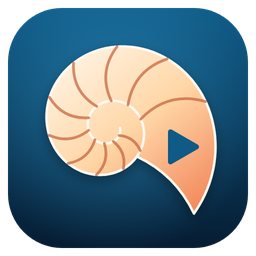

# Nautile — support

**Nautile** est un client pour [Jellyfin](https://jellyfin.org) sur Freebox Player, disponible sur le FreeStore.
Il permet de regarder les films et séries de votre propre serveur Jellyfin sur votre téléviseur.

Ce dépôt sert uniquement au support : le code source de l'application n'y est pas publié.

## Signaler un problème ou proposer une idée

- 🐞 **Un bug ?** → [Ouvrir un signalement](https://github.com/xavave/nautile-support/issues/new/choose)
- 💡 **Une idée d'amélioration ?** → même lien, choisir « Suggestion »
- 💬 **Une question ?** → [Discussions](https://github.com/xavave/nautile-support/discussions)
- ✉️ **Par e-mail** → nautile.support@gmail.com

Avant d'ouvrir un signalement, merci d'indiquer si possible : le modèle de Freebox Player, la version de Nautile (menu **À propos**) et la version de votre serveur Jellyfin.

⚠️ Ne publiez jamais l'adresse de votre serveur, votre identifiant ni votre mot de passe dans un signalement public.

## Questions fréquentes

**Nautile fournit-il des films ou des séries ?**
Non. Nautile lit uniquement les médias présents sur votre propre serveur Jellyfin.

**Comment fonctionne l'essai gratuit ?**
Vous disposez de 15 minutes de lecture gratuite par jour, toutes vidéos confondues ; le compteur repart à zéro chaque jour à minuit. Le temps restant est indiqué dans le menu « À propos ». Un achat unique de 1,49 € dans l'application débloque la lecture illimitée sur votre Freebox Player, sans abonnement.

**J'ai déjà payé mais l'application me propose encore de débloquer.**
L'achat est lié à votre compte Freebox : il est retrouvé automatiquement, même après une réinstallation. Si ce n'est pas le cas, relancez l'application ; si le problème persiste, écrivez-nous en joignant le journal de l'application (menu utilisateur > Journal).

**Mon serveur n'est pas trouvé.**
Vérifiez que l'adresse saisie est bien joignable depuis la Freebox (réseau local ou Internet), avec le bon port, et que le serveur Jellyfin est démarré.

---

Nautile est une application indépendante, non affiliée au projet Jellyfin. Jellyfin est une marque du projet Jellyfin.
